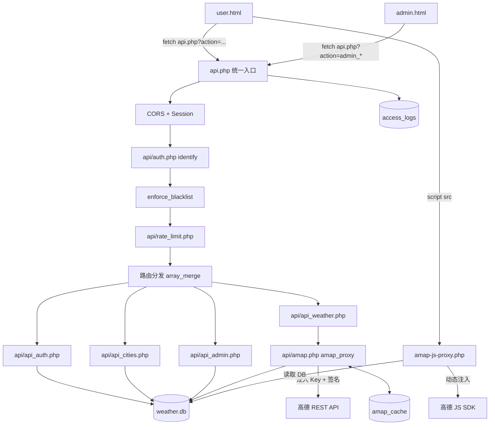

# 天气中心 · 系统设计与交接文档

> 版本：V1.1.0.1021（四段式：主版本.次版本.修订号.累加更新号） ｜ 技术栈：原生 HTML/CSS/JS + PHP 7.2+（推荐 7.4/8.x）+ SQLite + TOML ｜ 数据源：高德开放平台
>
> 本文档面向后续开发者与接手人员，涵盖目录结构、模块职责、数据库设计、鉴权限流、调用关系、数据流向、部署与安全注意事项。
> 根目录 [README.md](../README.md) 提供简要说明与快速开始。
> 部署操作手册见同目录 [DEPLOY.md](DEPLOY.md)；接口明细见 [API.md](API.md)。

---

## 1. 系统概述

| 层级 | 实现 | 说明 |
|------|------|------|
| 用户端 | `user.html` | 单页应用：搜索联想、实时天气、预报、地图标注、关注城市、深色模式、自动刷新、注册登录 |
| 管理后台 | `admin.html` | 单页应用：数据看板、访问日志、用户新增/停用/封禁/警告/重置密码、站点图标与验证邮箱、系统配置、黑名单、修改管理员密码 |
| 后端入口 | `api.php` | 所有请求统一路由（`api.php?action=xxx`），负责鉴权、黑名单、限流、日志与统一响应 |
| 数据存储 | `weather.db`（SQLite）+ `config.toml` | 数据库只存用户与业务数据；配置在 TOML，不写死在代码中 |
| 地图/天气 | 高德开放平台 | REST 接口由后端代理；JS API 密钥由后端动态注入 |

安全设计核心：**前端源码与页面中不出现任何高德密钥**，所有密钥只存在于服务端 `config.toml`（位于 `/api/` 目录，整体拒绝 Web 访问）。

---

## 2. 目录结构

> 入口页面与 `api.php` 位于项目根目录；后端模块统一在 `api/`；文档归档在 `doc/`。根目录速查见 [../mulu.md](../mulu.md)。

```
站点根目录/
├─ 入口页面（浏览器可直接访问）
│  ├─ index.html            入口导航页（用户端 / 管理后台）
│  ├─ user.html             用户端单页应用
│  ├─ admin.html            管理后台单页应用
│  ├─ 404.html              静态 404 页面
│  ├─ api.php               统一入口：CORS → Session → 身份识别 → 黑名单 → 鉴权 → 限流 → 路由 → 日志 → 统一 JSON（保留在根目录）
│  ├─ amap-js-proxy.php     JS API 安全配置输出 + SDK 动态加载器（密钥运行时注入）
│  └─ favicon.svg           默认页面图标（后台 site_icon 可覆盖）
│
├─ api/                     后端模块（禁止 Web 直接访问）
│  ├─ config.php            从根目录 config.toml 读取 APP_ROOT / API_DIR / DB_FILE / 时区 / 版本
│  ├─ toml.php              TOML 解析/序列化、原子保存、文件锁、自动备份、热重载
│  ├─ helpers.php           统一响应、参数读取、IP/指纹、CORS、HTTP 客户端、日志写入
│  ├─ db.php                SQLite 连接、自动建表、配置读写、GC
│  ├─ auth.php              身份识别、黑名单校验、登录/登出封装、登录失败防护
│  ├─ rate_limit.php        分层限流中间件（游客 IP+指纹 / 用户账号配额）
│  ├─ amap.php              高德 REST 代理：签名、缓存、调用统计、JS 配置读取
│  ├─ api_auth.php          公共身份接口（初始化、注册、登录、登出、me、ping）
│  ├─ api_weather.php       天气 / 联想 / 逆地理 / 地理编码（全部走高德代理）
│  ├─ api_cities.php        关注城市增删改查
│  ├─ api_admin.php         管理后台全部接口
│  ├─ api_update.php        在线更新：清单校验、下载、全量备份、失败自动回退
│  └─ .htaccess             Apache 下拒绝 Web 直接访问 api/ 目录
│
├─ 数据与部署配置
│  ├─ config.toml            唯一配置源（DB 路径 / 时区 / 语言 / 版本 / 高德 Key / 限流 / 注册开关）
│  ├─ schema.sql            完整建表 SQL（SQLite 方言，首次访问自动执行）
│  ├─ example_config.toml   配置模板（复制为 config.toml）
│  ├─ .htaccess             Apache 根目录安全策略（宝塔 Nginx 不生效，含 404 页面）
│  └─ .user.ini             宝塔/PHP-FPM 用户级配置（已移除旧主机的失效 open_basedir）
│
├─ 运行时自动生成（不要上传）
│  ├─ weather.db            SQLite 主库
│  ├─ weather.db-wal        WAL 模式预写日志
│  ├─ weather.db-shm        共享内存索引
│  └─ update_backups/       在线更新全量备份（代码/配置/数据库，保留最近 5 份）
│
├─ 文档与索引
│  ├─ VERSION              当前版本定义（1.1.0.1021，四段式）
│  ├─ LICENSE               MIT License
│  ├─ README.md             项目简要说明（快速开始 / 文档入口）
│  ├─ CONTRIBUTORS.md       贡献者名单与贡献方式
│  ├─ mulu.md               根目录速查入口
│  └─ doc/
│     ├─ README.md          本文档（架构、数据流、部署、安全）
│     ├─ API.md             接口文档（参数、返回、错误码、示例）
│     └─ DEPLOY.md          部署手册（宝塔 / Apache / Nginx）
│
└─ .codeartsdoer/           IDE 工具目录，不参与部署，不要上传
```

### 2.1 结构约定

1. 入口页面与 `api.php`、`amap-js-proxy.php` 留在站点根目录；后端实现模块统一放 `api/`，不新增其他代码目录；
2. `api/` 目录整体禁止 Web 访问（Nginx `location ^~ /api/` 或 Apache `api/.htaccess`），新增后端模块直接放入 `api/` 即可；
3. 新增文档统一放 `doc/`，并在同一次改动中同步 `doc/README.md` 与根目录 `mulu.md` 的索引；
4. 系统配置统一写 `config.toml`（不写回代码或数据库）；
5. `api/config.php` 中 `APP_ROOT` 指向项目根目录、`API_DIR` 指向 `api/`；`schema.sql` 与 `weather.db` 位于根目录；
6. `weather.db*` 属于运行时数据，不纳入代码交付，首次访问 `api.php?action=ping` 时自动生成。

### 2.2 访问控制

| 路径 | 直接访问 | 依据 |
|------|----------|------|
| `index.html` / `user.html` / `admin.html` / `404.html` | 允许 | 静态页面 |
| `api.php` / `amap-js-proxy.php` | 允许 | 唯一后端对外入口 |
| `/api/` 整个目录 | 拒绝 | `api/.htaccess`；宝塔需 Nginx 规则 |
| `config.toml` / `config.toml.lock` / `config_backups/` / `update_backups/` | 拒绝 | 根 `.htaccess`；宝塔需 Nginx 规则 |
| `schema.sql` / `weather.db*` / `.user.ini` / `.htaccess` | 拒绝 | 根 `.htaccess`；宝塔需 Nginx 规则 |
| `README.md` / `mulu.md` / `doc/*.md` | 拒绝 | 同上 |

> 宝塔默认使用 Nginx，`.htaccess` 不生效，必须按 8.4.5 加入 `location ^~ /api/` 规则，以及 `.toml/.bak/.lock` 扩展名拒绝规则。

### 2.3 部署文件清单

- **必需（根目录）**：`api.php`、`amap-js-proxy.php`、`index.html`、`user.html`、`admin.html`、`404.html`、`favicon.svg`、`schema.sql`、`config.toml`；
- **必需（api/ 目录）**：`config.php`、`toml.php`、`helpers.php`、`db.php`、`auth.php`、`rate_limit.php`、`amap.php`、`api_auth.php`、`api_weather.php`、`api_cities.php`、`api_admin.php`、`api_update.php`；
- **按环境需要**：`.htaccess` 与 `api/.htaccess`（Apache）、`.user.ini`（宝塔/PHP-FPM 建议）、Nginx 规则（宝塔/通用 Nginx 必须）；
- **可选**：`LICENSE`、`README.md`、`CONTRIBUTORS.md`、`VERSION`、`example_config.toml`、`doc/`、`mulu.md`；
- **不要上传**：`.codeartsdoer/`、`.git/`、`.gitignore`、`config_backups/`、`config_backups/.snapshot`、`update_backups/`、本地生成的 `weather.db*`（迁移场景除外）。

详细步骤见 [DEPLOY.md 4.2](DEPLOY.md#42-上传文件)。

---

## 3. 模块职责与依赖

| 文件 | 职责 | 依赖 |
|------|------|------|
| `api.php` | 根目录唯一入口：加载模块、组装路由、中间件编排、统一日志与响应 | `api/*` |
| `api/config.php` | 从 `config.toml` 读取并定义 `APP_ROOT`（项目根）、`API_DIR`（api 目录）、`DB_FILE`、`APP_TIMEZONE`、`APP_VERSION`、`APP_LANGUAGE`、`SESSION_NAME` | `api/toml.php` |
| `api/toml.php` | TOML 解析/序列化、默认值、原子保存、文件锁、热重载辅助 | 无 |
| `api/helpers.php` | `json_out()` 统一响应、`fail()` 抛业务异常、`param()` 读参、`apply_cors()`、`client_ip()`、`client_fingerprint()`、`http_get()`、`log_access()` | `api/db.php`（配置与日志） |
| `api/db.php` | PDO 单例、建表、旧 `system_config` 迁移、TOML 配置读写（`config_all` / `get_config` / `set_config_many`）、GC | 根目录 `schema.sql` |
| `api/auth.php` | `identify()` 双模式识别、`enforce_blacklist()`、`require_login/admin`、`authenticate()`、`session_login/logout`、`login_fail_guard()` | `api/helpers.php`、`api/db.php` |
| `api/rate_limit.php` | `rate_check()`：游客按 IP+指纹，用户按 `user_id`，管理员放行 | `api/db.php`、`api/helpers.php` |
| `api/amap.php` | `amap_proxy()`：参数白名单、Key 注入、数字签名、缓存、调用统计；`amap_js_config()` | `api/db.php`、`api/helpers.php` |
| `api/api_auth.php` | `auth_*` 处理函数 + 路由数组 | `api/auth.php` |
| `api/api_weather.php` | `wx_*` 处理函数 + 路由数组 | `api/amap.php` |
| `api/api_cities.php` | `city_*` 处理函数 + 路由数组 | `api/db.php` |
| `api/api_admin.php` | `adm_*` 处理函数 + 路由数组 | `api/db.php`、`api/auth.php` |
| `api/api_update.php` | `admin_update_*` 处理函数 + 路由数组：清单校验、下载、全量备份、代码替换、健康检查与回退 | `api/db.php`、`api/toml.php`、`api/helpers.php` |
| `amap-js-proxy.php` | 根目录入口：读取 JS Key / 安全密钥，输出 `window._AMapSecurityConfig` 与 `window.__AMap_READY` | `api/db.php`、`api/amap.php` |

> 路由模块约定：每个 `api/api_*.php` 末尾 `return [...]`，键为 action 名，值为 `['auth' => public|guest_token|user|admin, 'rate' => bool, 'amap' => bool, 'handler' => callable]`。根目录 `api.php` 用 `array_merge` 合并，便于按模块扩展。

---

## 4. 数据库与配置

### 4.1 数据库用途

数据库只保存**用户与业务数据**（账号、关注城市、访问日志、游客令牌、黑名单、高德缓存与调用统计）。
系统配置统一存放在 [`config.toml`](../config.toml)，不再使用 `system_config` 表。

建表 SQL 全文见根目录 [`schema.sql`](../schema.sql)。首次请求 `api.php` 时自动执行：

- 新库：`PRAGMA user_version` 0 → 1（建表）→ 2（配置迁移）→ 3（用户字段迁移）；
- 旧库：自动补配置并升级用户表字段（`email` / `account_state` / `warning` / `warned_at`），最终版本 3；
- 迁移完成并确认无误后，可手动执行 `DROP TABLE IF EXISTS system_config;`。

### 4.2 核心数据表

| 表 | 关键字段 | 说明 |
|----|----------|------|
| `users` | `id, username(UNIQUE), password_hash, role(user/admin), status(1/0), email, account_state, warning, warned_at, fingerprint, last_ip, last_login_at, created_at` | 账号表；`status=0` 表示停用或封禁，细分状态见 `account_state`（active/disabled/banned） |
| `user_cities` | `id, user_id, adcode, city_name, sort_order, created_at`，`UNIQUE(user_id, city_name)` | 关注城市；`sort_order` 用于排序权重 |
| `access_logs` | `id, created_at, ts, ip, fingerprint, user_id, action, method, status, code, elapsed_ms, ua` | 访问日志；限流统计、看板趋势、后台日志均基于此表 |

### 4.3 辅助数据表

| 表 | 用途 |
|----|------|
| `guest_tokens` | 游客令牌（token 主键、绑定 fingerprint、过期时间、吊销标记） |
| `blacklist` | IP / 浏览器指纹黑名单，`UNIQUE(type, value)` |
| `amap_cache` | 高德代理结果缓存（`cache_key` 主键、payload JSON、`expires_at`） |
| `amap_calls` | 高德调用记录（成功率、延迟、缓存命中、错误信息），用于后台看板 |

### 4.4 配置文件（`config.toml`）

> 首次部署可复制根目录 [example_config.toml](../example_config.toml) 为 `config.toml`；模板不含真实 Key。

| 键 | 默认值 | 含义 |
|----|--------|------|
| `site_name` | 天气中心 | 站点名称 |
| `site_icon` | favicon.svg | 页面图标（URL、data:image 或相对路径） |
| `admin_email` | 空 | 管理员验证/联系邮箱；仅保存与格式校验，不包含 SMTP 发信 |
| `app_version` | 1.1.0.1021 | 站点版本号（四段式）；`ping` 返回该值 |
| `update_manifest_url` | 空 | 在线更新清单 HTTPS JSON 地址；空表示关闭在线更新 |
| `timezone` | Asia/Shanghai | PHP 时区（IANA 名称） |
| `language` | zh-CN | 站点语言（`zh-CN` / `en-US`） |
| `default_city` | 深圳 | 用户端默认城市 |
| `auto_refresh` | 300 | 默认自动刷新间隔（秒） |
| `allow_origin` | 空 | 跨域白名单，逗号分隔；空表示仅允许同源 |
| `trust_proxy` | false | 是否信任 `X-Forwarded-For`（有 CDN/反代时开启） |
| `register_enabled` | true | 注册开关 |
| `database_path` | weather.db | SQLite 路径；相对项目根或绝对路径 |
| `amap_web_key` / `amap_web_secret` | 空 | 后端 REST 服务 Key 与安全密钥 |
| `amap_js_key` / `amap_js_security_code` | 空 | 前端 JS API Key 与安全密钥 |
| `amap_daily_quota` | 5000 | 每日调用配额，用于后台估算剩余量；0 表示不限 |
| `guest_rate_limit` | 60 | 游客每窗口业务请求上限 |
| `guest_amap_rate_limit` | 20 | 游客每窗口高德代理请求上限（更严格） |
| `user_rate_limit` | 120 | 登录账号每窗口配额 |
| `rate_window` | 60 | 限流窗口（秒） |
| `login_fail_limit` / `login_fail_window` | 10 / 600 | 登录失败次数上限与统计窗口（秒） |
| `guest_token_ttl` | 3600 | 游客令牌有效期（秒） |
| `cache_ttl_weather` | 600 | 天气缓存（秒） |
| `cache_ttl_tips` | 300 | 联想缓存（秒） |
| `cache_ttl_regeo` / `cache_ttl_geocode` | 86400 | 逆地理 / 地理编码缓存（秒） |
| `log_retain_days` | 30 | 日志、调用记录保留天数（GC 清理） |

**读写与热重载：**

- `api/toml.php` 负责解析/序列化；保存时使用文件锁 + 临时文件 + `rename` 原子替换，并写入根目录 `config_backups/`；
- 自动备份：保存配置或检测到外部修改时，写入 `config_backups/config-时间戳.toml`（保留最近 20 份）；检测快照为 `config_backups/.snapshot`；
- 恢复：把 `config_backups/` 中需要的备份复制为根目录 `config.toml`；恢复前建议先备份当前文件；
- `config_all()` 每次调用检查 `config.toml` 的 `mtime/size`，外部修改后自动重载；
- `timezone`、`language`、`app_version`、`database_path` 属于请求级配置，下一次请求生效；其余业务配置保存后立即生效；
- 配置目录与文件必须对 PHP 运行用户可写（宝塔为 `www`）。

> `db_gc()` 以约 2% 的请求概率触发，清理过期缓存、过期令牌、超期日志与调用记录，避免表无限增长。

---

## 5. 鉴权、限流与封禁

### 5.1 双模式身份识别（`auth.php::identify()`）

```
请求 → 有 Session(uid)?
        ├─ 是 → 查 users；status=0 → 1008 封禁；否则 identity.type = user（取 role）
        └─ 否 → 有 X-Guest-Token?
                ├─ 有 → 校验：存在 / 未吊销 / 未过期 / 指纹匹配 → identity.type = guest
                └─ 无 → 游客（无令牌）；业务接口会被 require_guest_token 拦截
```

- **登录用户**：PHP Session（`WEATHER_SESSID`，HttpOnly、SameSite=Lax、HTTPS 自动 Secure）。限流按账号配额。
- **游客**：`guest_init` 签发一次性令牌，令牌与浏览器指纹（Canvas + UA + 屏幕等生成 16 位哈希）绑定。前端将令牌存于 `localStorage`，请求头携带 `X-Guest-Token` 与 `X-Fingerprint`。令牌过期/失效时前端自动重新初始化。
- **一次性语义**：每次初始化签发新令牌并绑定指纹；令牌在有效期内可复用（会话级），过期、被吊销或指纹不匹配即作废。相比"每次请求换新令牌"可避免多标签页/并发请求互相失效。

### 5.2 中间件顺序（`api.php`）

1. `db_init()` / `db_gc()`
2. `apply_cors()`（同源或无 Origin 放行；配置白名单时按白名单）
3. `session_start()`
4. `identify()`（公开初始化接口允许携带失效令牌重新初始化）
5. `enforce_blacklist()` —— IP / 指纹在 `blacklist` 表中 → `code=1003, HTTP 403`
6. 路由鉴权：`guest_token` / `user` / `admin`
7. `rate_check()` —— 游客 IP+指纹双维度；用户账号维度；管理员跳过
8. 业务处理 → 写 `access_logs` → 统一 JSON

### 5.3 限流规则

| 身份 | 维度 | 默认阈值 | 说明 |
|------|------|----------|------|
| 游客 | IP 与指纹取较大值 | 60 次/60 秒 | 高德代理接口使用 `guest_amap_rate_limit`（20 次/60 秒） |
| 登录用户 | `user_id` | 120 次/60 秒 | 不受 IP/指纹限制 |
| 管理员 | 不限流 | —— | 后台接口统一 `rate=false` |

限流统计基于 `access_logs` 窗口内记录，排除 `ping`、`guest_init`、`me`、`login` 等初始化接口。超限返回 `code=1005, HTTP 429`，并附带 `X-RateLimit-Limit` / `X-RateLimit-Remaining` 响应头。

登录防爆破：`login` / `admin_login` 在同一 IP 的失败次数达到 `login_fail_limit` 时直接 429。

### 5.4 封禁

- **账号封禁**：`users.status=0`，`identify()` 每次请求校验并踢掉 Session，返回 1008。
- **IP / 指纹黑名单**：`blacklist` 表，`enforce_blacklist()` 对所有接口生效（含初始化接口），返回 1003。
- 管理员操作约束：不能封禁当前登录账号；不能封禁最后一个可用管理员。

---

## 6. 密钥保护与高德代理

### 6.1 REST 接口（天气 / 联想 / 逆地理 / 地理编码）

前端只调用 `api.php?action=weather|tips|regeo|geocode`，后端 `amap_proxy()`：

1. 从 `config.toml`（经 `config_all()`）读取 `amap_web_key` / `amap_web_secret`（未配置返回 2001）；
2. 过滤空参数，构造缓存键 `amap:<service>:md5(参数)`；
3. 命中 `amap_cache` 且未过期则直接返回并记录 `cache-hit`；
4. 注入 `key`；若配置了安全密钥则按高德规则签名（参数 key 升序 `k=v&...` + secret 取 md5）；
5. `http_get()`（cURL 优先，回退 `file_get_contents`）请求高德；
6. 校验 `status=1`，失败记录 `amap_calls` 并返回通用错误（不向前端泄漏高德内部 info）；
7. 写缓存并返回 payload。

### 6.2 JS API（地图）

`user.html` 只引入本地代理脚本：

```html
<script src="amap-js-proxy.php"></script>
```

该文件从数据库读取 JS Key 与安全密钥，输出：

```js
window._AMapSecurityConfig = { securityJsCode: "..." };
window.__AMAP_READY = new Promise(...动态创建 <script src="https://webapi.amap.com/maps?v=2.0&key=...">...);
```

页面 HTML/JS 源码中没有任何 key 字面量。前端通过 `await window.__AMAP_READY` 获取 `AMap` 后初始化地图。若未配置 Key，Promise reject，页面显示占位提示，天气功能不受影响。

> 注意：JS API 的 Key 最终必须由浏览器携带，运行时在开发者工具网络面板可见，这是高德 JS API 的固有机制。代码层面已做到"源码不暴露"，并建议在高德控制台配置域名白名单进一步限制。

---

## 7. 调用关系与数据流向



### 7.1 天气查询数据流

```
用户输入/选择城市
  → user.html api('weather', {city: adcode或城市名})
  → api.php?action=weather（携带 X-Guest-Token / X-Fingerprint 或 Session）
  → identify → 黑名单 → require_guest_token → rate_check(amap=true)
  → wx_weather：若 city 非 adcode，先 amap_proxy('geocode') 解析 adcode
  → amap_proxy('weather')
      → 查 amap_cache（10 分钟）命中则返回
      → 未命中：注入 key/sig → 高德 /v3/weather/weatherInfo?extensions=all
      → 校验 status → 写缓存 + amap_calls
  → 返回 {lives, forecasts, cached, adcode, city}
  → 前端 renderWeather()（全部字段 esc 转义；无实况时展示今日预报温度范围）
  → 并行/续接 geocode 获取坐标 → AMap 标注 + InfoWindow
  → 写 access_logs
```

### 7.2 地点联想

输入框 debounce 280ms → `action=tips` → 游客高德限流 → `amap_proxy('tips')`（缓存 5 分钟）→ 前端最多渲染 12 条，点击后带 `adcode/location` 直接查询天气并定位地图。

### 7.3 游客初始化

`user.html` 计算/复用浏览器指纹 → `action=guest_init` → 后端校验指纹格式、吊销旧令牌、写入 `guest_tokens` → 返回 token/expires_in → 前端存 `localStorage` 并在后续请求头携带。令牌失效时（1002）前端自动重新初始化并重试一次。

### 7.4 注册 / 登录

- 注册：校验注册开关（关闭返回 1006）→ 用户名/密码格式 → 唯一性 → `password_hash()` 入库 → 自动 `session_login()`。
- 登录：失败计数防护 → `password_verify()` → 校验 status → `session_regenerate_id(true)` → 更新最近登录信息。
- 退出：销毁 Session 并删除 Cookie。

### 7.5 关注城市

仅登录用户可访问（`auth=user`）：`cities_list` / `cities_add`（上限 30、去重）/ `cities_del`（校验归属）/ `cities_reorder`（预留排序接口）。前端侧栏渲染，点击直接切换天气。

### 7.6 后台看板

`admin_overview` 实时聚合：
- 今日请求量：`access_logs COUNT(ts >= 今日0点)`
- 24 小时趋势：取今日 `ts` 后用 PHP `date('G')` 按小时聚合（避免 SQLite 时区差异）
- 高德状态：`amap_calls` 统计真实调用/成功/失败/缓存命中/平均延迟
- 剩余配额：`amap_daily_quota - 今日真实调用数`（缓存命中不消耗配额）
- 最近调用：最新 15 条

### 7.7 后台配置

`admin_config_save` 按白名单校验字段类型、枚举、数值范围、时区、版本号与数据库路径 → `set_config_many()` 写入 `config.toml`（文件锁 + 临时文件 + rename + 自动备份）→ `config_all(true)` 刷新。高德 Key、限流、注册开关等保存后立即生效；`timezone`、`language`、`app_version`、`database_path` 在下一次请求生效。`config_all()` 每次调用检查文件 `mtime/size`，实现外部修改后的热重载。

### 7.8 日志与 GC

每个请求（含失败）写 `access_logs`（耗时由 `$startTime` 计算）。`db_gc()` 按概率清理：过期 `amap_cache`、超期 `guest_tokens`、超过 `log_retain_days` 的 `access_logs` / `amap_calls`。

---

## 8. 部署与初始化

### 8.1 环境要求

| 项目 | 要求 |
|------|------|
| PHP | 7.2+，推荐 7.4 / 8.0 / 8.1 / 8.2（代码同样兼容 8.3） |
| 必需扩展 | `pdo_sqlite`（SQLite 驱动） |
| 推荐扩展 | `curl`（未启用时自动回退 `file_get_contents`，需 `allow_url_fopen=On`） |
| 可选扩展 | `openssl`、`mbstring`（缺失时相关逻辑已自动降级） |
| 目录权限 | 站点根目录**可写**（用于创建 `weather.db`、`-wal`、`-shm`） |
| Web 服务器 | 宝塔默认 Nginx；Apache 可直接使用 `.htaccess` |

### 8.2 首次初始化

1. 上传全部文件到站点根目录；
2. 访问 `api.php?action=ping`（或直接打开 `user.html`）；
3. `db_init()` 自动执行 `schema.sql`，写入默认配置与管理员账号，生成 `weather.db`；
4. 打开 `admin.html` 使用默认账号登录：
   - 账号：`admin`
   - 密码：`admin123`
5. **立即修改密码**：后台「系统配置 → 管理员密码」。
6. 在后台「系统配置 → 高德开放平台」填写：
   - Web 服务 Key / 安全密钥（后端天气、联想、逆地理）
   - JS API Key / 安全密钥（前端地图）
7. 保存后立即生效，刷新用户端即可看到天气与地图。

### 8.3 修改管理员密码（备用方式）

若忘记密码，可在服务器执行 PHP 生成哈希，再更新数据库：

```bash
php -r 'echo password_hash("你的新密码", PASSWORD_DEFAULT), PHP_EOL;'
```

```sql
UPDATE users SET password_hash = '上面输出的哈希' WHERE username = 'admin';
```

> 也可参考 `doc/API.md` 中的 `admin_change_password` 接口。

### 8.4 宝塔面板（BT Panel）部署

#### 8.4.1 建站与上传

- 宝塔「网站 → 添加站点」，PHP 版本选择 **7.4 / 8.0 / 8.1 / 8.2**，站点根目录例如 `/www/wwwroot/weather.yousb.top`；
- **运行目录保持 `/`**（本项目入口文件均在根目录，不要设置为 `public` 等子目录）；默认首页 `index.html` 已存在；
- 将本项目全部文件上传到站点根目录；
- **无需配置伪静态**：系统不使用 URL 重写，所有请求形如 `api.php?action=xxx`。

#### 8.4.2 安装 / 确认 PHP 扩展

- 宝塔「软件商店 → PHP-xx → 设置 → 安装扩展」确认已安装：
  - 必需：`pdo_sqlite`
  - 推荐：`sqlite3`、`curl`
  - 可选：`mbstring`（缺失不影响运行，代码已做兼容）
- 扩展缺失时，`api.php` 会直接返回：`PHP 未启用 pdo_sqlite 扩展，请在宝塔面板…安装后重试`。

#### 8.4.3 `.user.ini` 与防跨站

- 本项目 `.user.ini` 已删除旧主机遗留的 `open_basedir=/data/wwwweb/...`（该路径在宝塔上不存在，会导致全站 500），仅保留 `display_errors=Off`、`log_errors=On`；
- 若在「网站 → 设置 → 网站目录」开启「防跨站攻击(open_basedir)」，宝塔会按当前站点路径写入 `.user.ini`；建议关闭后再开启一次，让面板重写为正确路径；
- `.user.ini` 由 PHP-FPM 缓存（默认 `user_ini.cache_ttl=300` 秒），修改后等待约 5 分钟或在宝塔重启 PHP 生效；
- 若将数据库放到站点目录之外，需把该目录加入 `open_basedir`（或关闭防跨站）。

#### 8.4.4 目录权限

宝塔 PHP-FPM 以 `www` 用户运行，上传后属主可能是 `root`，需要修正：

```bash
chown -R www:www /www/wwwroot/weather.yousb.top
find /www/wwwroot/weather.yousb.top -type d -exec chmod 755 {} \;
find /www/wwwroot/weather.yousb.top -type f -exec chmod 644 {} \;
```

`weather.db` 由 PHP 进程创建，无需预先建库；若已存在但只读，执行 `chown www:www weather.db*`。
`config.toml` 需要允许 PHP 进程写入（后台保存配置），建议 `chown www:www config.toml` 并设置 `644`。
`config_backups/` 与 `config_backups/.snapshot` 由 PHP 自动创建，需确保项目根目录可写（`chown -R` 已覆盖）。

#### 8.4.5 Nginx 安全规则（重点）

宝塔默认使用 **Nginx**，项目内的 `.htaccess` **不会生效**。请把以下规则加入站点配置文件（`/www/server/panel/vhost/nginx/你的站点.conf`），位置必须在 `include enable-php-*.conf;` 或 `location ~ [^/]\.php(/|$)` **之前**（Nginx 正则 location 按书写顺序匹配）：

```nginx
# 禁止下载 SQLite 数据库、建表脚本、配置与文档
location ~* \.(db|db-wal|db-shm|sqlite|sql|md|ini|log|toml|bak|tmp|lock)$ {
    return 404;
}

# 后端模块目录整体禁止直接访问（根目录 api.php 与 amap-js-proxy.php 不受影响）
location = /api { return 404; }
location ^~ /api/ { return 404; }

# 配置自动备份目录禁止直接访问（含高德 Key）
location = /config_backups { return 404; }
location ^~ /config_backups/ { return 404; }
```

修改后执行 `nginx -t` 校验并重载（宝塔面板可直接点「重载配置」）。

> 根目录 `config.toml` 依赖上述 `.toml` 扩展名规则拒绝访问；请勿删除该规则。

> 可选加固：把数据库移出 Web 根目录。例如创建 `/www/data/weather/`（属主 `www`），在 `config.toml` 中把 `database_path` 改为绝对路径，或通过站点配置传入：
> `fastcgi_param WEATHER_DB_FILE /www/data/weather/weather.db;`
> （`WEATHER_DB_FILE` 环境变量优先级高于 `database_path`）。同时确保该目录在 `open_basedir` 范围内。

#### 8.4.6 PHP 配置建议（宝塔「PHP 设置 → 配置修改」）

```ini
display_errors = Off
log_errors = On
error_log = /www/wwwlogs/php_error.log
expose_php = Off
date.timezone = Asia/Shanghai
session.cookie_httponly = 1
max_execution_time = 60
memory_limit = 128M
post_max_size = 8M
upload_max_filesize = 8M
allow_url_fopen = On
```

保存后重启 PHP。若启用了 opcache 且 `opcache.validate_timestamps=0`，部署新代码后需重启 PHP 才能生效。

#### 8.4.7 防火墙 / 防篡改 / WAF

- **网站防篡改**：会将站点目录设为只读，导致 SQLite 无法写入（提示“数据库目录不可写”）；请关闭或把站点目录加入白名单；
- **宝塔 Nginx WAF**：可能对高频访问或含 SQL 关键字的搜索词返回 403/429，请在 WAF 日志中确认后放行；
- 系统自身也会返回 429（业务码 1005），注意与 WAF 拦截区分；
- 宝塔开启「强制 HTTPS」后，`api/config.php` 的 `is_https()` 会正常识别，Session Cookie 自动加 `Secure`。

#### 8.4.8 备份（宝塔计划任务）

```bash
STAMP=$(date +%F_%H%M)
mkdir -p /www/backup/weather/$STAMP
cp -a /www/wwwroot/weather.yousb.top/weather.db* /www/backup/weather/$STAMP/
cp -a /www/wwwroot/weather.yousb.top/config.toml /www/backup/weather/$STAMP/
cp -a /www/wwwroot/weather.yousb.top/config_backups /www/backup/weather/$STAMP/ 2>/dev/null || true
```

建议每天低峰期执行；也可在宝塔「文件」中离线打包 `weather.db`、`weather.db-wal`、`weather.db-shm` 与 `config.toml`。宝塔内置的 MySQL 备份不适用于 SQLite。

#### 8.4.9 常见问题排查

| 现象 | 排查方向 |
|------|----------|
| 全站 500 / 空白 | 多为 `.user.ini` 旧 `open_basedir`；确认按 8.4.3 处理；查看 `/www/server/php/{版本}/var/log/php-fpm.log` 与站点错误日志 |
| `api.php` 返回 5000 且提示 pdo_sqlite | 在宝塔 PHP 设置中安装 `pdo_sqlite` 扩展 |
| 提示“数据库目录不可写” | `chown -R www:www`、检查目录权限；关闭网站防篡改 |
| 登录后立即掉线 | `session.save_path` 权限、`open_basedir` 未包含 `/tmp`、HTTPS/域名不一致 |
| 天气接口 2001 / 2003 | 后台未填 Web 服务 Key；高德控制台未开通 Web 服务；启用数字签名但 secret 不匹配 |
| 地图区域空白 | 后台未填 JS Key / 安全密钥；高德控制台未配置域名白名单；页面为 HTTPS |
| 高德接口响应异常 2002 | 服务器无法访问 `restapi.amap.com`；安装 `curl` 或开启 `allow_url_fopen`；检查出站防火墙 |
| 修改 `.user.ini` 不生效 | PHP-FPM 缓存 300 秒，重启 PHP 即可 |
| 页面 403 且非系统返回 | 宝塔 WAF / 防火墙拦截，查 WAF 日志并加白 |

### 8.5 Apache 场景

- 保留根目录 `.htaccess` 与 `api/.htaccess`，均需 `AllowOverride All` 生效；
- 根 `.htaccess` 保护数据库、SQL、文档等敏感文件；`api/.htaccess` 拒绝 Web 直接访问后端模块目录；
- 不影响根目录 `api.php` / `amap-js-proxy.php` 通过文件系统加载模块。

### 8.6 中国时区

`api/config.php` 已设置 `Asia/Shanghai`。若服务器时区不同，PHP 生成的日志时间与令牌过期均使用该时区/时间戳，不影响逻辑。

---

## 9. 安全设计清单

| 项目 | 实现 |
|------|------|
| 密钥保护 | 高德 Key 仅存根目录 `config.toml`（Nginx 拒绝 `.toml`，Apache 由 `.htaccess` 拒绝；自动备份在 `config_backups/` 目录级 404 下）；前端通过 `api.php` / `amap-js-proxy.php` 代理，源码无明文 |
| 密码存储 | `password_hash(PASSWORD_DEFAULT)` / `password_verify()`，禁止明文 |
| XSS 防护 | 前端所有动态文本经 `esc()` 转义（`& < > " '`），属性值同样转义；不使用 `innerHTML` 拼接未转义数据 |
| SQL 注入 | 全部使用 PDO 预处理；分页 LIMIT/OFFSET 强制整型拼接 |
| CSRF | Session Cookie `SameSite=Lax` + 全部写操作使用 JSON POST；跨域默认仅同源 |
| 暴力破解 | 登录失败计数 + 限流 + 429 |
| 越权 | 关注城市操作校验 `user_id` 归属；管理员接口强制 `role=admin`；不能封禁自己/最后管理员 |
| 游客滥用 | 一次性令牌 + 指纹绑定 + IP/指纹双维度限流，高德接口更严格 |
| 日志 | 记录 IP、指纹、UID、接口、状态、耗时；不记录密码与密钥 |
| 错误信息 | 高德内部错误只写日志，前端返回通用信息 |
| 目录访问 | `.htaccess` 禁止 `.db/.sql/.md/.ini/.toml/.bak/.tmp/.lock` 与目录索引；建议 Nginx 同步配置 |

---

## 10. 运维建议

### 10.1 在线更新（可选）

后台页头版本号旁的「详情」提供版本查看与在线更新：检查更新、全量备份后更新、失败自动回退、手动回退到上一节点。

- **更新源**：在「系统配置 → 更新与维护」填写 `update_manifest_url`，必须是 HTTPS JSON 清单；
- **清单格式**：`version`（四段式）、`download_url`（HTTPS ZIP）、可选 `sha256`、`release_url`、`notes`；
- **包结构**：完整项目 ZIP（根目录含 `api.php` 或唯一顶层目录），必须包含入口页面、`api/` 全部模块、`schema.sql`、`VERSION`；**不要包含** `config.toml` 与 `weather.db*`（更新时会被忽略）；
- **备份位置**：`update_backups/backup-时间戳-版本/`，包含 `code/`、`config.toml`、`db/`、`backup.json`，保留最近 5 份；
- **保护目录**：更新只替换代码，保留 `config.toml`、`weather.db*`、`config_backups/`、`update_backups/`、`.git/`、`.codeartsdoer/`、`.user.ini`；
- **健康检查**：更新与回退后都会请求 `api.php?action=ping`，版本不一致视为失败并自动回退；
- **环境要求**：PHP `zip`（ZipArchive）扩展；`curl` 优先，无 curl 时回退 `file_get_contents`；`update_backups/` 需对 PHP 运行用户可写；
- **安全**：清单、下载地址与重定向均只接受 HTTPS；ZIP 解压拒绝绝对路径、`..`、盘符与符号链接。

### 10.2 日常建议

- **备份**：定期备份 `weather.db` 与 `config.toml`（含 WAL 时建议先执行 `PRAGMA wal_checkpoint(TRUNCATE);` 或直接停写后复制三个数据库文件）。
- **日志**：后台「访问日志」支持按 IP / 接口 / 用户 / 日期筛选分页；超期自动清理（默认 30 天）。
- **配额监控**：后台看板展示今日真实调用、缓存命中、成功率与估算剩余配额。
- **缓存调优**：天气 10 分钟、联想 5 分钟、地理编码 1 天；若高德配额紧张可适当调大 `cache_ttl_*`。
- **限流调优**：先在后台观察日志量，再调整 `guest_rate_limit` / `user_rate_limit` / `rate_window`。
- **反向代理**：若使用 CDN，开启 `trust_proxy` 并确保来源可信，否则 IP 黑名单会失效或误伤。

---

## 11. 已知限制与扩展方向

1. **游客令牌**为会话级（有效期内可复用），不是严格"一次请求一令牌"；如需严格一次性，可在每次业务请求后 `revoke` 并返回新令牌（需前端同步更新）。
2. **剩余配额**为本地估算值，高德 REST 接口不返回实时剩余配额。
3. **普通用户改密码/找回密码**尚未实现（管理员改密已实现），可复用 `password_hash` 流程扩展。
4. **SQLite 并发写**：已启用 WAL 与 5 秒 busy_timeout，适合中小流量；高并发场景建议迁移 MySQL。
5. **`regeo` / `cities_reorder` / `ping`** 为预留接口，前端暂未使用；可在后续版本扩展定位按钮与拖拽排序。
6. **JS API Key 运行时可见**：由高德 JS API 机制决定，建议配置域名白名单与安全密钥。
7. **验证邮箱未接入 SMTP**：当前仅保存并校验管理员/用户邮箱，不发送验证码或通知；如需发信需另行配置邮件服务。

---

## 12. 许可证与第三方服务

本项目采用 [MIT License](../LICENSE) 发布。Copyright (c) 2026 风铃 (https://github.com/dison0331)。

贡献者记录见 [CONTRIBUTORS.md](../CONTRIBUTORS.md)。

第三方服务说明：

- 本项目仅封装调用【高德开放平台 API】，**高德 API 不属于本开源代码范围**；
- 使用时必须自行前往高德开放平台注册账号、申请 Key，遵守《高德地图开放平台服务协议》；
- 在对外展示地图/结果时，按高德要求展示高德归属标注；
- 高德服务有额度、计费、测绘合规限制，本作者不对高德 API 可用性、数据准确性承担任何责任；
- 本项目不包含高德地图 SDK 源码；地图数据、服务及相关商标归高德所有，本项目与高德无隶属或代理关系。

## 13. 版本号规范

本项目统一采用四段式版本号 **VX.X.Y.Z**；配置文件与接口返回使用纯数字 `X.X.Y.Z`。

| 段 | 名称 | 含义 |
|----|------|------|
| X | 主版本号 | 不兼容的重大变更或大的功能分段 |
| X | 次版本号 | 向下兼容的功能更新 |
| Y | 修订号 | 小版本更新 |
| Z | 累加更新号 | 每次构建或发布递增的累计序号 |

- 当前版本：`V1.1.0.1021`（存储与接口：`1.1.0.1021`）
- 版本定义文件：根目录 `VERSION`
- 对外展示：README、doc 文档、管理后台页头与登录页、用户端状态栏、入口页、`ping` / `config_public`
- 兼容策略：后台允许保存旧三段值 `X.Y.Z`，新填写值使用四段；历史变更记录保留原始格式
- 本项目当前没有程序集、安装包或发布标签构建流程；后续如增加，必须沿用该四段式

## 14. 变更记录

| 版本 | 日期 | 说明 |
|------|------|------|
| v1.0.0 | 2026-11-19 | 初版：完成用户端、管理后台、统一 API、SQLite 配置化、双模式鉴权、限流、缓存、黑名单、看板与文档 |
| v1.0.1 | 2026-11-19 | 宝塔面板（BT Panel）兼容：修复失效 `.user.ini` 的 `open_basedir`；Session Cookie 参数兼容 PHP 7.2+；新增 `pdo_sqlite` 检测与可读错误提示；WAL 初始化容错；支持 `WEATHER_DB_FILE` 将数据库外置；移除 `X-Powered-By`；补充宝塔 Nginx、PHP、权限、防篡改与备份部署文档 |
| v1.0.2 | 2026-11-19 | 修复直接输入中文城市名时实时天气（lives）为空：天气查询先用地理编码解析 adcode 再请求高德，接口返回解析后的 `adcode` / `city`；前端在无实况时降级展示今日预报温度范围，并保存解析后的 adcode 供自动刷新与关注城市使用；侧栏增加关注城市空状态提示 |
| v1.0.3 | 2026-11-19 | 后端模块目录化：10 个 PHP 模块移入 `api/`，根目录仅保留 `api.php` 与 `amap-js-proxy.php` 作为入口；`api/config.php` 新增 `API_DIR` 并将 `APP_ROOT` 指向项目根；Nginx/Apache 访问控制改为目录级（`location ^~ /api/`、`api/.htaccess`）；同步更新目录结构、部署清单与文档索引 |
| v1.0.4 | 2026-11-19 | 配置架构调整：新增 `config.toml` 与轻量 TOML 解析器 `api/toml.php`；数据库路径、时区、语言、版本号、高德 Key、限流、注册开关统一写入 TOML，支持 mtime 热重载、文件锁、原子写与自动备份；SQLite 只保留用户与业务数据，旧 `system_config` 自动迁移；后台新增语言/时区/版本/数据库路径字段 |
| v1.1.0 | 2026-11-20 | 版本号升级至 1.1.0；配置架构沿用 v1.0.4；新增后台验证邮箱配置、站点图标/名称动态化、用户创建/停用/封禁/警告/重置密码、用户邮箱与账号细分状态（数据库 user_version 3） |
| v1.1.0.1021 | 2026-11-20 | 版本号统一为四段式 V1.1.0.1021；新增根目录 `VERSION` 定义文件与各页面版本展示；后台版本校验兼容旧三段值，新值使用四段 |
| 未发布 | 2026-11-20 | 新增管理后台在线更新：版本号旁「详情」面板、检查更新、全量备份后更新、失败自动回退与手动回退；新增配置 `update_manifest_url`、模块 `api/api_update.php` 与运行时目录 `update_backups/` |